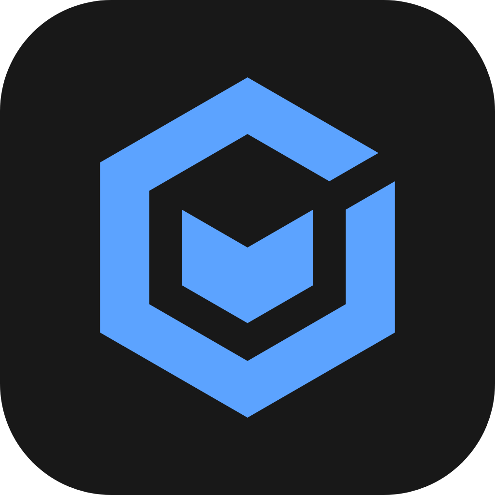

# The Monorithm icon

The icon of Monorithm is an open box in a hexagon ring. A pointy-top hexagon ring has one door at its upper-right vertex. In the core is a cube with its top face open: its right face and its left face are one shape. The eye completes the cube, and the open top makes it a box that you look into. The icon is signal blue on a graphite tile. Use it for the organization, the websites, and the repositories.

## The construction

The grid is 256 × 256, and the centre of the mark is at (128, 128). The outer hexagon has a circumradius of 118, and its apothem A is 102.19.

The mark has two widths only:

- *t*, the solids: the ring band (across an edge) and the height of each face of the cube.
- *g*, the spaces: the space between the ring and the cube, and the door.

*t* : *g* is 1.5 : 1, thus *t* = 34.06 and *g* = 22.71. The two faces of the cube are one shape, with no space between them. The mark is the same at all sizes, from 16 px to a sign.

The canonical file is the mark in the favicon of `ux.monorithm.dev` (`public/favicon.svg` of `github.com/monorithm/ux`). `monorithm-mark.svg` is the same mark in black.

The door is a straight cut of the width *g* along the line from the centre to the upper-right vertex. All corners are sharp. Crisp edges are necessary for the cube illusion. All openings are real gaps between shapes, not shapes in the color of the ground.

On a tile, the mark is 11/16 of the tile height.

## The colors

| Use | Mark | Ground |
| --- | --- | --- |
| Primary: the tile | `#5ca3ff` | `#181818` |
| On a light ground, one color | `#1f6fe0` | The light ground |
| One color, black | `#000000` | A light ground |
| One color, white | `#ffffff` | A dark ground |

`#5ca3ff` on `#181818` gives a contrast of 6.9 : 1.

## The files

| File | Use |
| --- | --- |
| `monorithm-mark.svg` | The master: the mark in black, on a transparent ground |
| `monorithm-app-icon.svg`, `monorithm-app-icon-1024.png` | The tile with rounded corners |
| `monorithm-avatar.svg`, `monorithm-avatar-1024.png` | The GitHub avatar: a full square. GitHub rounds the corners |
| `monorithm-social.svg`, `monorithm-social-1280x640.png` | The social preview of a repository or a page |
| `monorithm-black`, `-white`, `-mono-1f6fe0`, `-mono-5ca3ff`, `-square` | The one-color versions, in SVG and in PNG at 1024 px |
| `favicon.svg`, `favicon.ico`, `favicon-16/32/48.png` | The favicon: the tile with the mark. `favicon.svg` is the canonical file |
| `apple-touch-icon.png`, `icon-192.png`, `icon-512.png`, `maskable-512.png`, `site.webmanifest` | The web icons of a site |

## The rules

- Use the tile when the ground is not graphite.
- Keep clear space around the mark of a minimum of the width *t*.
- Do not turn or mirror the mark: the door is always at the upper right.
- Do not change the colors, the proportions, or the corners. Do not add a shadow, an outline, or a gradient.
- Do not put text in the mark.

## The source

On 15 November 2026, the user selected this icon after four rounds of concepts. The first source was the favicon of the language site (a hexagon ring in `#5ca3ff` on `#181818`). Then came a cube illusion in the centre, an asymmetric opening, and one rule of even widths (solid 2 : space 1). Then the top face of the cube opened. Last, the user made the favicon mark canonical: one shape for the two faces.
